<p align="center">
  <picture><source media="(prefers-color-scheme: dark)" srcset="docs/images/hero-dark.webp?v=3"></picture>
</p>

<p align="center">
  
  
  
  
</p>

<p align="center">
  <b>Pick up a file. Press Shift. Drop it on an action.</b><br>
  A menu bar app for macOS 26 that turns the pointer into a ring of file tools and system controls, drawn in Liquid Glass.
</p>

> [!NOTE]
> **Beta, and a vibe-coded project.** Shiftio is built with AI: the code is written by Claude Code under my direction, and I steer it by running the app and checking the result. It is early software (version 0.1.10 beta): expect rough edges, and please open an issue when something breaks.

---

**Shiftio** lives in the menu bar. Drag any file (or several) and press **Shift**: a ring of actions opens under the pointer. Convert it, compress it, trim it, crop it, annotate it, preview it, transcribe it. Drop the file on a tile and the result is saved next to the original. Hold **⌥⇧** with nothing in your hand and a second ring opens with system controls, your apps, folders and Telegram chats.

Your files are processed on the Mac and never uploaded. No account, no Accessibility permission, no notifications. The internet is needed only to start the free trial and to activate a license; after that Shiftio works offline.

## Install

1. Download **Shiftio.dmg** (or **Shiftio.zip**) from the [latest release](../../releases/latest) and drag Shiftio to Applications.
2. The beta is **not notarized** by Apple yet, so macOS may say the app is damaged or from an unidentified developer. Clear the quarantine flag once and open it again:
   ```bash
   xattr -dr com.apple.quarantine /Applications/Shiftio.app
   ```
3. Requires macOS 26 and an Apple silicon Mac. The MP3 encoder, the video converter (ffmpeg) and the speech model are downloaded on first launch, and the first launch needs an internet connection to start the free trial.

## Price and license

Shiftio is a paid app with a **14-day free trial** that has every feature.

- **Trial.** Open Shiftio for the first time (with the internet on) and your 14 days start. The start date is kept on a server, so reinstalling or changing the Mac's clock does not give more time.
- **A free month for everyone who downloads from GitHub.** Open **Settings → License**, paste the key below and press **Activate**:

  ```
  SHIFTIO-GITHUB-MONTH
  ```

  It gives you the full app for **30 days from the day you activate it** on your Mac (each Mac has its own 30 days, and one Mac can't renew it). Activating needs an internet connection.
- **Buy.** A license costs **$0.99** (one-time) on [Gumroad](https://118628564410.gumroad.com/l/shiftio). The license key arrives in your purchase email.
- **Activate.** Open **Settings → License**, paste the key and press **Activate**. Activating needs an internet connection; once it is done, Shiftio works fully **offline**, as long as you like.
- **Three Macs.** One key works on up to 3 of your Macs. To move it, press **Deactivate This Mac** on the old one (Settings → License) and activate the new one.
- **When the trial ends** the rings stop until you enter a key. Your files and settings are never touched.
- **Refunds and revoked keys.** A key that was refunded stops working the next time Shiftio is online; the app then goes back to what is left of the trial.

## Contents

[What's new](#whats-new-in-0110) · [Price and license](#price-and-license) · [File ring](#the-file-ring) · [Pop-up ring](#the-pop-up-ring) · [Documents, data and folders](#documents-data-and-folders) · [Photo editor](#photo-editor) · [Quick tools](#quick-tools) · [Video editor](#video-editor) · [Video player](#video-player) · [Finder thumbnails](#finder-thumbnails-for-mkv-and-webm) · [Quick Look](#quick-look-previews) · [Audio editor](#audio-editor) · [Convert and compress](#convert-compress-and-more) · [Looks and themes](#looks-and-themes) · [Settings](#settings-and-first-launch) · [Privacy](#privacy-and-technology)

## What's new in 0.1.10

- **Touch Bar sliders look like the system's.** A thin track with the accent colour, a small white rounded knob that grows while you hold it, on a dark rounded plate.
- **Slider in the Quick Look video preview's Touch Bar** (it was squeezed to nothing).
- **⌘Q closes only the window in front** (the player, an editor or Settings), not all of them; Shiftio itself stays running.
- **Archive preview** is a plain list again; dragging files out of it is gone.

### Earlier: 0.1.9

- **Repair.** A new tile at the end of the Images → Edit ring: paint over something in a picture (a person, a wire, a blemish) and it is filled in from what is around it. It uses a Core ML model (LaMa) that is downloaded once, the first time you use it; if it can't be fetched, a built-in patch method takes over.
- **Upscale.** Next to it: make a picture bigger. *Super Resolution* (4×, uses the Mac's own scaler; its model downloads once) or the quicker Core Image methods.
- **Browse.** In the Folder ring next to *Extract*: look inside an archive (ZIP, 7z, RAR, TAR and the compressed forms) and take out only the files you pick.
- **Quick Look for more files.** Press Space in Finder on:
  - an **MKV or WebM** to play it right there, with sound and a slider (this was a spinner that never ended before);
  - an **archive** to see its folders and files as a list you can open up;
  - a **Markdown** file to see it rendered, or a **.torrent** to see its name, size, files, trackers and info hash.
- **Touch Bar in the editors.** Every slider of the editor on screen is on the Touch Bar, buttons on the left and sliders in the middle (the Quick Look player has play/pause and a slider there too).
- **Zoom in the video and audio trim.** A zoom bar, pinch and scroll on the timeline, for exact cuts.
- **Screen recording with the Mac's sound.** The System Audio button in a recording adds what the Mac plays to the movie.

### Earlier: 0.1.8

- **Space closes editor windows.** In Compress, Crop, Add Background, Redact, Annotate, Preview, Get Info and Extract Pages. (Trim Audio and Edit Video keep Space for play.)
- **Dolby Atmos in the player.** E-AC-3 JOC tracks play straight from the file when no delay or equalizer is used, so macOS recognises them as Dolby Atmos (checked on a real file with AirPods Pro).

### Earlier: 0.1.7

- **Trial and license.** A 14-day free trial, then a license key from Gumroad (see [Price and license](#price-and-license)). A new **License** tab in Settings shows the days left, takes your key and lets you deactivate a Mac. A key works on up to 3 Macs, and everything works offline after activation.
- **Play tool for video macOS can't open.** MKV, AVI, WebM, WMV, FLV and TS files get a **Play** tile (Media → Tools). Shiftio prepares a playable copy with ffmpeg (a few seconds when the picture can be copied as it is, otherwise it is re-encoded with the graphics chip) and opens it in a player with the usual macOS controls, audio-track and subtitle choice. The copy is deleted when you close the window.
- **Trial start shows its state** in the menu bar popover, with a button to enter a key.

### Earlier: 0.1.6

- **Docs, Data and Folders rings.** PDF and documents now share one *Docs* ring set, with a new **Data** ring (JSON, CSV, XML) and a **Folder** ring (ZIP, Get Info, and the same tools applied to what is inside a dropped folder).
- **Preview for Markdown, JSON and XML.** A viewer with images, tables and alerts, a collapsible JSON tree, and a *Preview / Code* switch.
- **Anything to PDF.** Word, RTF, HTML, text, Markdown, OpenDocument, and Pages, Keynote, Numbers and PowerPoint/Excel when the apps are installed.
- **PDF pages.** Split a PDF into single pages, or pick the pages to extract from thumbnails.
- **Archives.** Unpack ZIP, TAR and other archives next to the original; ZIP also works for a single file or folder.
- **Audio editor.** A waveform trimmer with fades, volume, normalize, speed, format choice and *Trim Silence*.
- **More video and image formats.** MKV, WebM and AVI in and out, long MKV and HEVC files open in the video editor; WebP, AVIF and SVG for images.
- **Focus** tile in the pop-up ring: switch Focus modes through your own Shortcuts.
- **Finder aliases** to folders and files are followed.
- A welcome page with a progress bar in the tour, and a consistent look across all editor windows.

## The file ring

Drag a file and press the trigger key (Shift by default). The ring shows what fits the file: images, PDFs, documents, audio, video, or several files at once. Press the key again to flip to the next ring (Convert, Edit, Optimize, Tools). Drop the file on a tile to run it; drop it in the empty centre to cancel.

<p align="center">
  <picture><source media="(prefers-color-scheme: dark)" srcset="docs/images/ring-images-dark.webp"></picture>
  <picture><source media="(prefers-color-scheme: dark)" srcset="docs/images/ring-edit-dark.webp"></picture>
</p>

- **Rings that adapt:** a different set for images, PDFs, documents, audio, video, and for several files at once.
- **Recent tools first:** the tools you used last and most often float to the front.
- **Fully configurable:** reorder tiles, rename them, give a tile your own icon or emoji, add **Shortcuts** or apps, add or remove whole rings.
- **Touch Bar support:** on Macs with a Touch Bar the open ring is mirrored there, tinted with your accent. Tap a tile to run the action, or the ring button to flip to the next ring; the Touch Bar follows the ring as you switch. No setup needed.

<p align="center">
  
</p>

<p align="center">
  <picture><source media="(prefers-color-scheme: dark)" srcset="docs/images/settings-rings-image-dark.webp"></picture>
</p>

## The pop-up ring

Hold **⌥⇧** (about 0.3 s), point at a tile and let go. No file needed.

<p align="center">
  <picture><source media="(prefers-color-scheme: dark)" srcset="docs/images/popup-dark.webp"></picture>
  <picture><source media="(prefers-color-scheme: dark)" srcset="docs/images/popup-apps-dark.webp"></picture>
</p>

- **System controls:** Wi-Fi, Bluetooth, appearance (auto, light, dark), keyboard backlight, Keep Awake (15 minutes, 1 hour, 4 hours, until off), System Settings, folders. Tiles with options open a second ring.
- **Focus:** add the Focus tile in the ring editor and switch Do Not Disturb, Work, Sleep and your other modes. macOS lets apps start Focus only through Shortcuts, so each mode runs a shortcut of yours (Settings → Rings → System → Focus).
- **Apps, folders and Telegram chats** that you pin yourself. Chat photos are read from Telegram or chosen by drag and drop.
- **Recent and frequent apps,** counted by Shiftio itself, as a separate tile or merged with your pins.
- **Screenshot and screen recording** tiles (area, window or screen) that open the result in Quick Look. Add them in the ring editor.
- **Music player** above the ring for Apple Music and Spotify: cover, play controls, a seek bar, synced lyrics and the queue.

<p align="center">
  <picture><source media="(prefers-color-scheme: dark)" srcset="docs/images/popup-player-dark.webp"></picture>
  <picture><source media="(prefers-color-scheme: dark)" srcset="docs/images/popup-recent-dark.webp"></picture>
</p>

## Documents, data and folders

The ring knows what a file is. A Markdown, JSON or XML file gets **Preview**; a folder gets its own ring; a CSV, JSON or XML file can be converted to the other two.

<p align="center">
  <picture><source media="(prefers-color-scheme: dark)" srcset="docs/images/ring-data-dark.webp">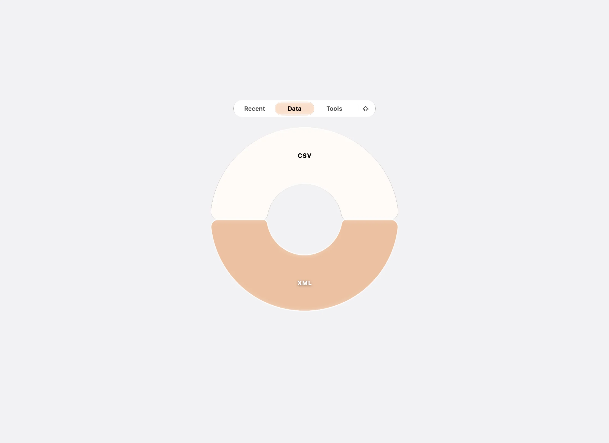</picture>
  <picture><source media="(prefers-color-scheme: dark)" srcset="docs/images/ring-video-dark.webp">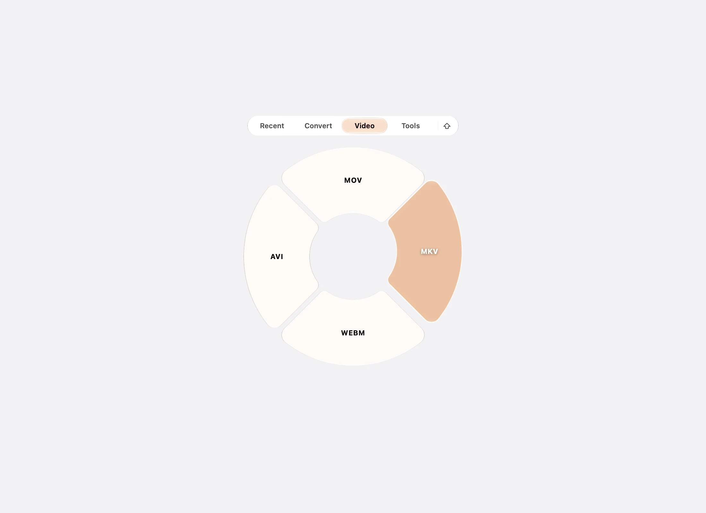</picture>
  <picture><source media="(prefers-color-scheme: dark)" srcset="docs/images/ring-folder-dark.webp">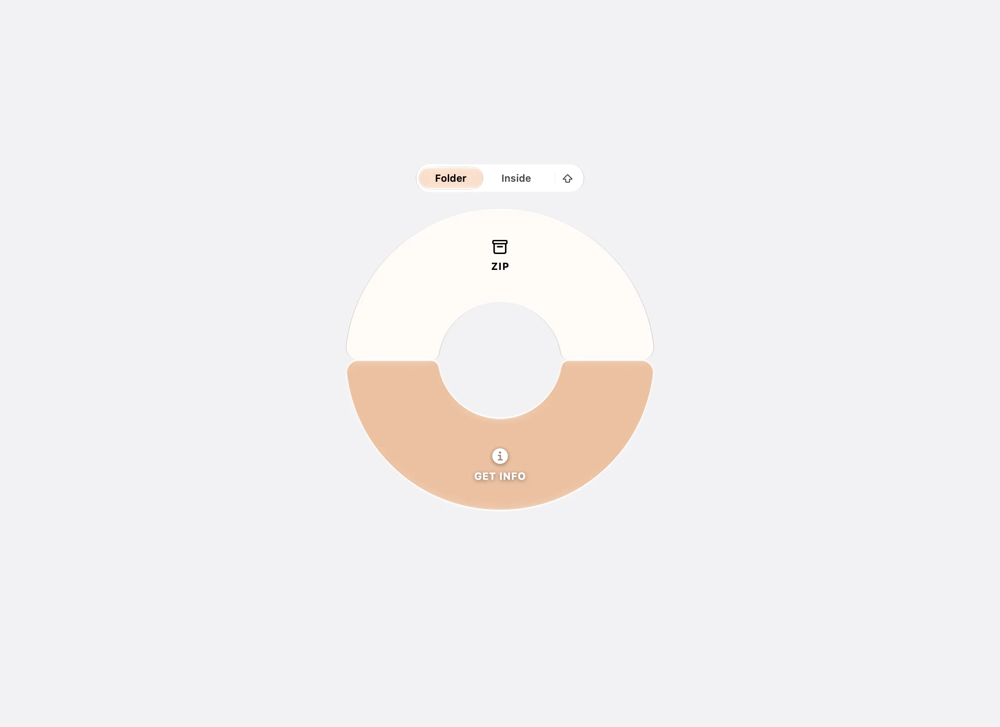</picture>
</p>

<p align="center">
  <picture><source media="(prefers-color-scheme: dark)" srcset="docs/images/tool-preview-dark.webp">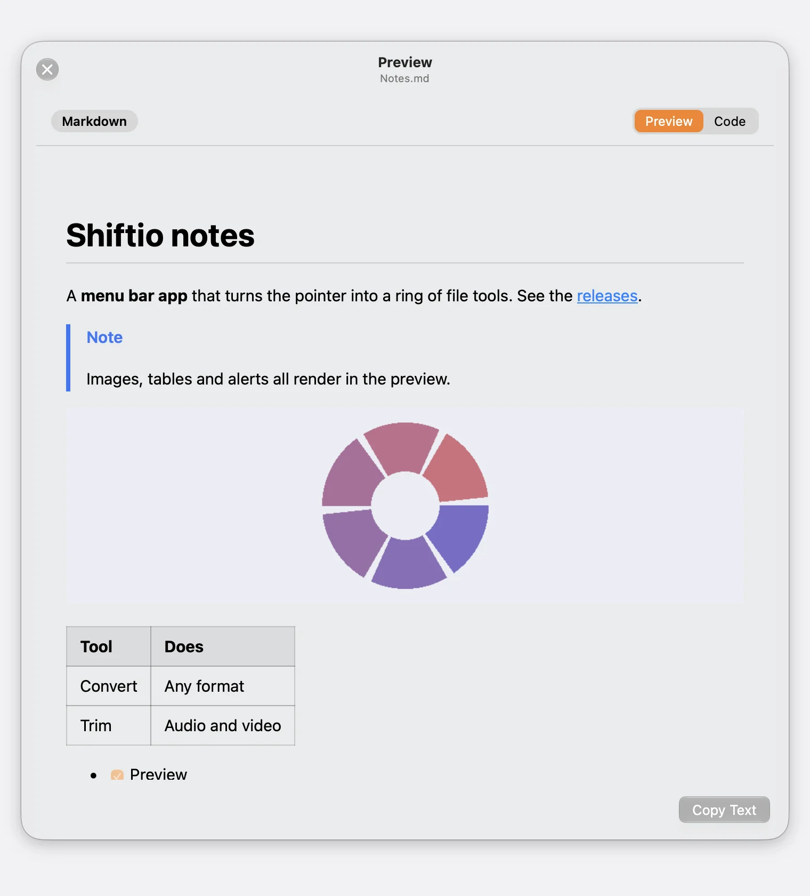</picture>
  <picture><source media="(prefers-color-scheme: dark)" srcset="docs/images/tool-preview-json-dark.webp">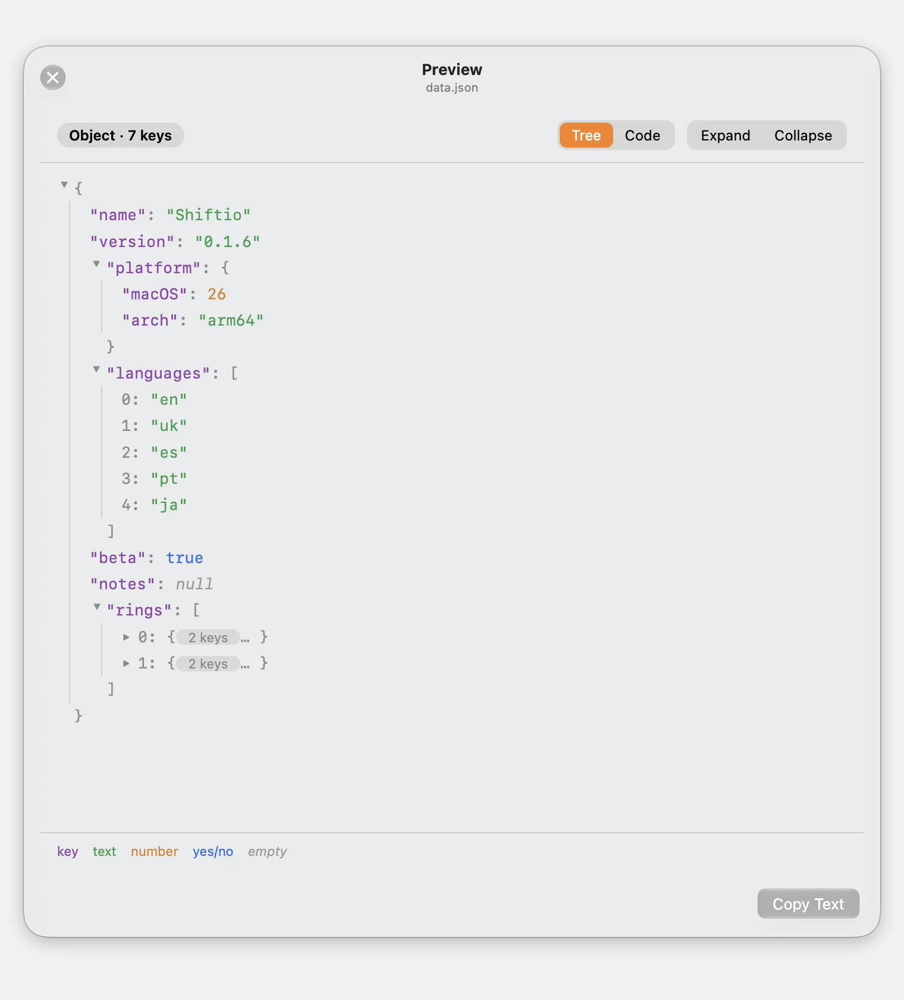</picture>
</p>

- **Markdown:** images (next to the file, remote or HTML ``), tables, task lists, code and GitHub alerts; convert to HTML, PDF or DOCX.
- **JSON:** an ordered tree you can fold, a code view with line numbers, the path of the value under the pointer, and the exact line and column when the file is not valid.
- **Any document to PDF:** Word, RTF, HTML, text and Markdown are laid out by macOS itself; Pages, Keynote, Numbers, PowerPoint and Excel files are exported through those apps if you have them.
- **Archives:** *Extract* unpacks everything; *Browse* lists what is inside (ZIP, 7z, RAR, TAR…) and extracts only the items you choose. Quick Look shows the same list.

<p align="center">
  <picture><source media="(prefers-color-scheme: dark)" srcset="docs/images/tool-browse-dark.webp">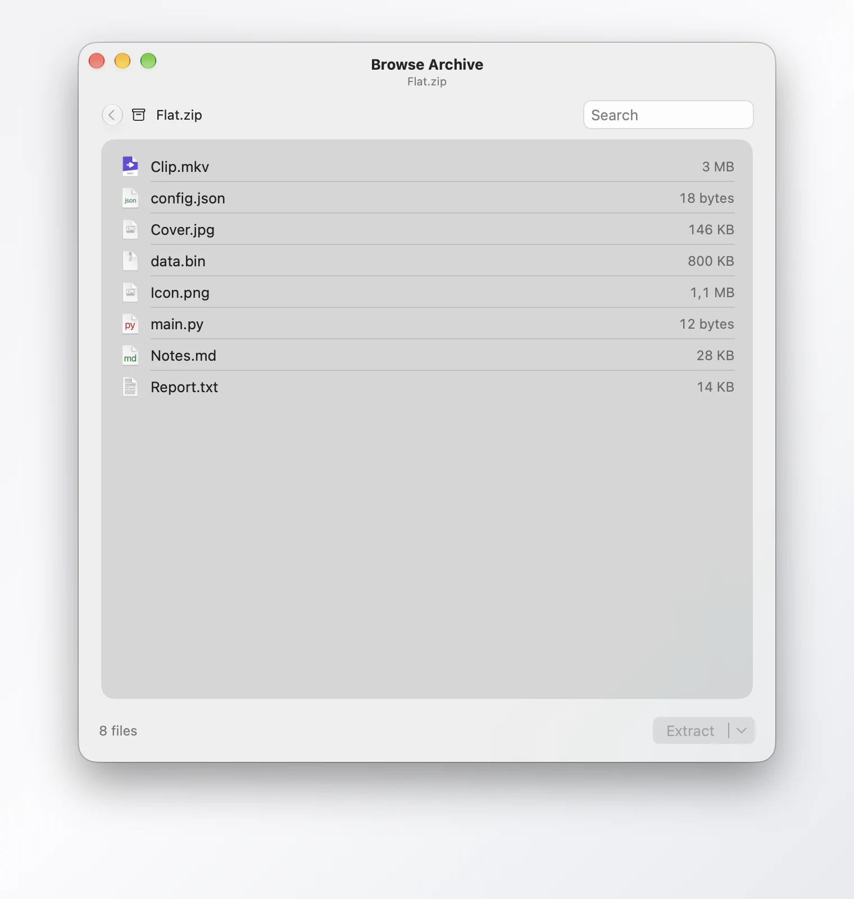</picture>
</p>
- **PDF pages:** *Split* writes one file per page into a folder; *Pages* shows thumbnails or takes a range like `1-3, 7`.

<p align="center">
  <picture><source media="(prefers-color-scheme: dark)" srcset="docs/images/tool-extract-pages-dark.webp">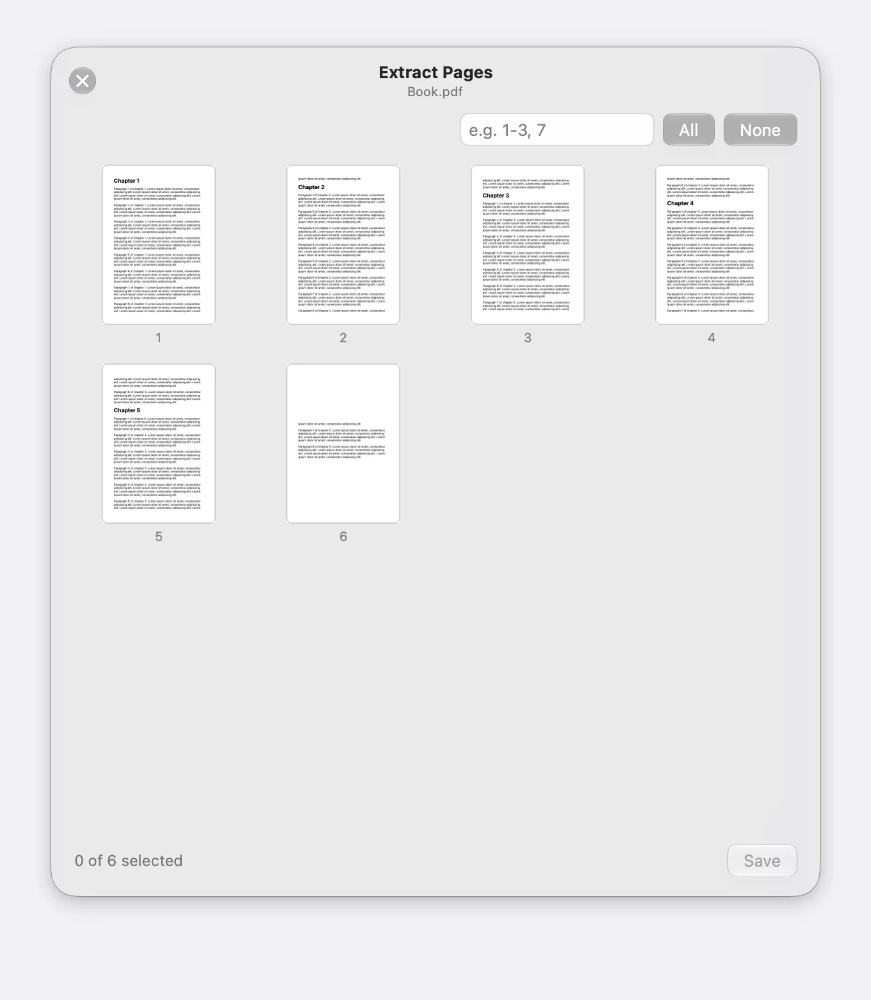</picture>
</p>

## Photo editor

A full non-destructive editor for images. Save as a copy or replace the original (the old file goes to the Trash).

<p align="center">
  <picture><source media="(prefers-color-scheme: dark)" srcset="docs/images/editor-filters-dark.webp"></picture>
  <picture><source media="(prefers-color-scheme: dark)" srcset="docs/images/editor-markup-dark.webp"></picture>
</p>

- **Adjust:** exposure, brightness, contrast, highlights, shadows, saturation, vibrance, warmth, tint, histogram, auto enhance.
- **Filters:** one-click looks (Vivid, Dramatic, Mono, Silvertone, Noir, Chrome, Fade, Instant, Process, Transfer, Sepia).
- **Crop and rotate:** aspect ratios, straighten, rotate and flip.
- **Markup:** arrows, rectangles, ellipses, pen, highlighter and text.
- **Repair:** paint over what should go and it is filled in from the surroundings (Core ML model downloaded on first use).
- **Upscale:** enlarge a picture, 4× with Super Resolution or a quicker Core Image method.
- **Compare** with the original (hold the button), zoom, full undo and redo.

<p align="center">
  <picture><source media="(prefers-color-scheme: dark)" srcset="docs/images/tool-repair-dark.webp">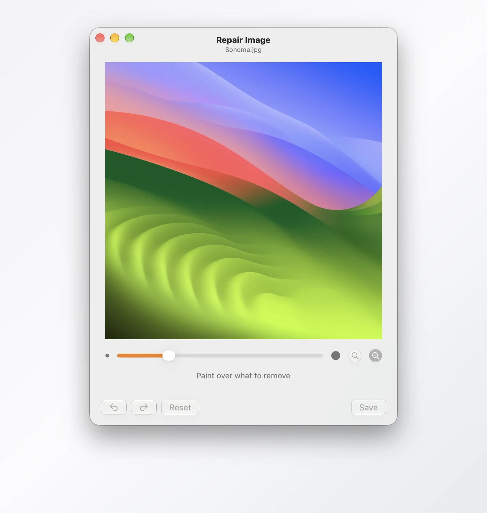</picture>
  <picture><source media="(prefers-color-scheme: dark)" srcset="docs/images/tool-upscale-dark.webp">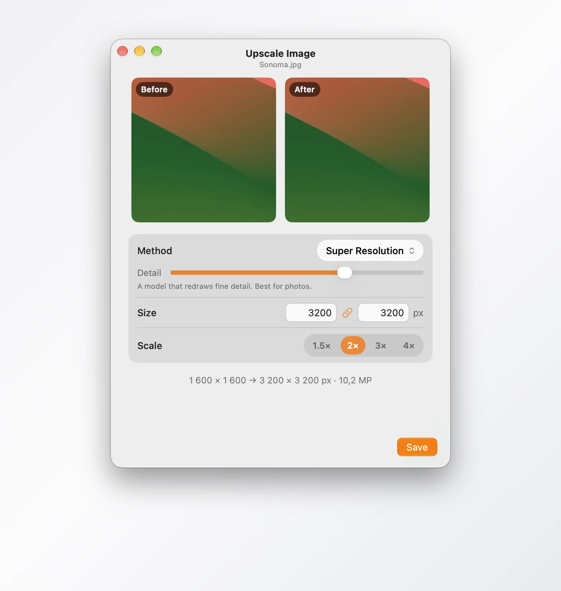</picture>
</p>

<p align="center">
  <picture><source media="(prefers-color-scheme: dark)" srcset="docs/images/editor-crop-dark.webp"></picture>
</p>

## Quick tools

Small focused windows that finish in one step.

<p align="center">
  <picture><source media="(prefers-color-scheme: dark)" srcset="docs/images/tool-add-bg-dark.webp"></picture>
  <picture><source media="(prefers-color-scheme: dark)" srcset="docs/images/tool-annotate-dark.webp"></picture>
  <picture><source media="(prefers-color-scheme: dark)" srcset="docs/images/tool-redact-dark.webp"></picture>
  <picture><source media="(prefers-color-scheme: dark)" srcset="docs/images/tool-compress-dark.webp"></picture>
</p>

- **Crop:** pixel sizes or aspect ratios, with a live preview.
- **Add a background:** gradients, colours, padding, rounded corners, shadow and ratio, perfect for screenshots.
- **Annotate:** the markup tools without the full editor.
- **Redact:** black out or pixelate; *Find Text* detects text on the image for you.
- **Remove background:** cut out the subject with on-device Vision masks.
- **Get Info:** size, dates, EXIF, location on a map, codec and bitrate for video.

<p align="center">
  <picture><source media="(prefers-color-scheme: dark)" srcset="docs/images/tool-info-dark.webp"></picture>
  <picture><source media="(prefers-color-scheme: dark)" srcset="docs/images/tool-info-video-dark.webp"></picture>
  <picture><source media="(prefers-color-scheme: dark)" srcset="docs/images/tool-compress-video-dark.webp"></picture>
</p>

## Video editor

<p align="center">
  <picture><source media="(prefers-color-scheme: dark)" srcset="docs/images/video-clip-dark.webp"></picture>
  <picture><source media="(prefers-color-scheme: dark)" srcset="docs/images/video-picture-dark.webp"></picture>
  <picture><source media="(prefers-color-scheme: dark)" srcset="docs/images/video-sound-dark.webp"></picture>
  <picture><source media="(prefers-color-scheme: dark)" srcset="docs/images/video-save-dark.webp"></picture>
</p>

- **Clip:** trim, cut out, split, join clips, speed (0.5× to 2×), fade in and out, play backwards.
- **Picture:** crop to a ratio, rotate, flip.
- **Sound:** volume, normalize, reduce noise, replace the soundtrack, or mute.
- **Overlay:** text or image watermark, blur or pixelate a region, burn in subtitles or export an SRT file.
- **Save as:** MP4, HEVC, ProRes or GIF, with presets and a size limit for messengers (8, 10, 16, 25, 50 MB).
- **Play:** MKV, AVI, WebM, WMV, FLV and TS files that macOS can't open open in a player (Media → Tools → Play).

## Video player

MKV, AVI, WebM, WMV, FLV and TS files that macOS can't open get a **Play** tile (Media → Tools). They open in Shiftio's own player.

- **Starts at once.** A short copy of the beginning plays right away, while the rest of the file is prepared in the background, so even a 30 GB film starts in a moment. Jump ahead of what is ready and the player waits for it.
- **Video tab.** HDR switch and Brightness, Contrast, Saturation, Gamma and Hue sliders (double-click a slider to reset it).
- **Picture tab.** Choose the **aspect ratio** (4:3, 16:9, 16:10, 21:9, 5:4 and more): the window takes that shape and the extra at the edges is cut away (or the picture is stretched, if you pick that), so no black bars are left. **Crop** to a ratio inside the same window; zoom from 100% to 400% (drag the picture to move it, pinch on a trackpad); rotate and flip.
- **Audio tab.** Every audio track with its language, an external audio file, a delay from -5 to +5 seconds, and a 10-band equalizer (32 Hz to 16 kHz, ±12 dB) with presets.
- **Subtitles tab.** Two subtitle lines at once (primary at the bottom, secondary at the top), taken from the file or from SRT, ASS, SSA and VTT files, with delay, position, scale, font, colour, border and shadow.
- **Your layout.** The controls float, or sit at the top or bottom; the sidebar goes on either side. The file name is shown at the top.
- **Carries on where you left off.** Close a film and open it again, and it starts from the same place (a few seconds back), with a short note saying so.
- **Picture in Picture.** The button next to the speed puts the film in a small floating window.
- **Full screen.** The file name is shown in macOS's own bar at the top, not on the picture.
- **Keys.** Space plays and pauses, ← and → jump 5 seconds (30 with ⇧), ↑ and ↓ change the volume, M mutes, F goes full screen.

Files macOS can play (MP4, MOV) are not changed; the player is for the rest. ffmpeg, which prepares the file, is downloaded on first use like the other components, and the prepared copy is deleted when you close the window.

## Finder thumbnails for MKV and WebM

macOS shows a plain icon for Matroska (`.mkv`) and WebM videos. Shiftio ships a Quick Look extension that puts a frame of the film on the icon instead, in every folder, with no setup and without touching your files.

- **Formats.** MKV and WebM with H.264, HEVC or VP9 video (and AV1 on Macs that decode it in hardware). Anything macOS already shows (MP4, MOV, images, PDFs, text, audio) is left to the system.
- **It reads the file itself** and decodes the frame with the system's video decoders; nothing is uploaded and ffmpeg is not needed for this.
- **Switch.** Shiftio turns it on the first time it opens. It is a switch in **Settings → General → Thumbnails for MKV and WebM**; the button next to it opens the list of Quick Look extensions in System Settings.
- **If the icons stay plain,** press **Refresh Thumbnails** in the same place and reopen the folder. macOS keeps its choice of thumbnail maker for a kind of file until its thumbnail service restarts; that button restarts it (no need to log out).

## Quick Look previews

Press Space on these files in Finder (the extensions come with the app and turn on with it):

<p align="center">
  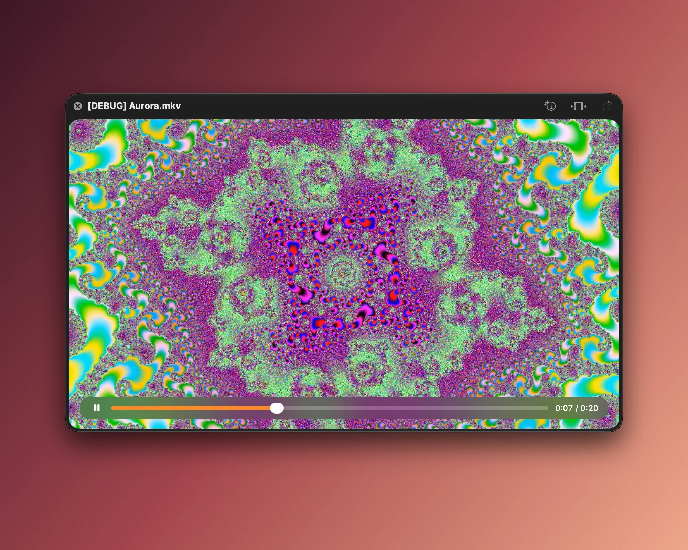
</p>

- **MKV and WebM** play in the preview, with sound, a play button and a slider (H.264, HEVC, VP9 and AV1 video; AAC, AC-3, E-AC-3 and MP3 sound). The Touch Bar gets play/pause and a slider.

<p align="center">
  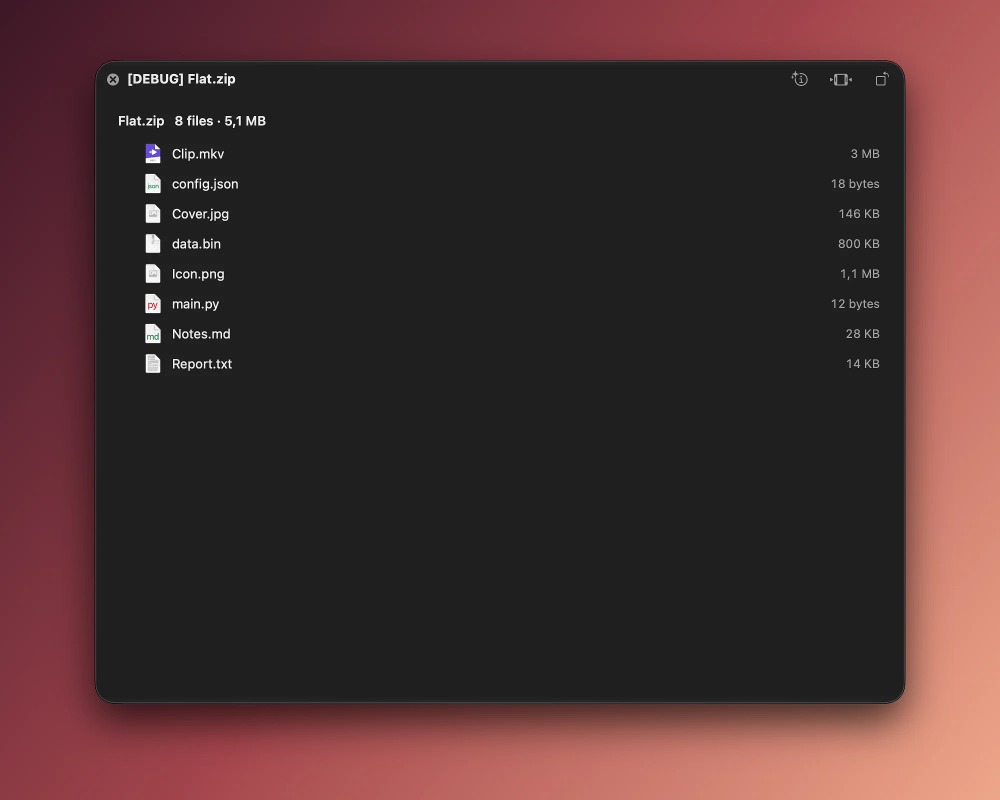
  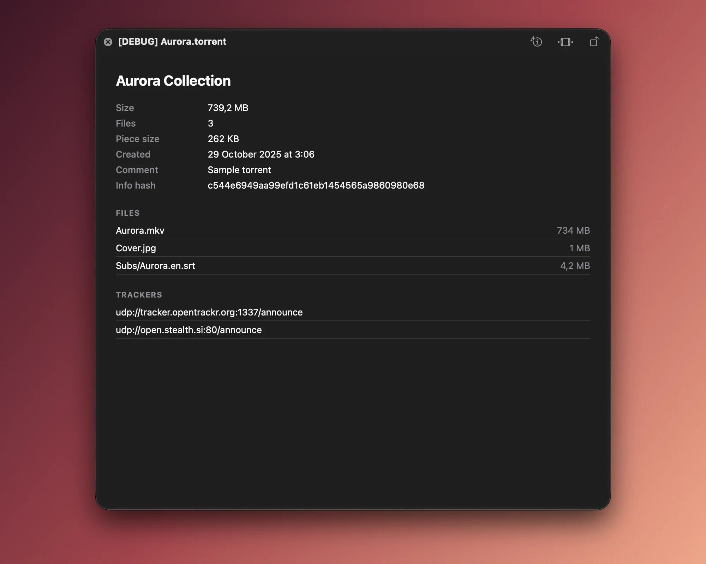
</p>

- **Archives** (ZIP, 7z, RAR, TAR…) show their folders and files as a list you can open up.
- **.torrent** files show the name, size, files, trackers and info hash, with no torrent client needed.
- **Markdown** files are shown rendered.

## Audio editor

Drag an audio file onto **Trim**: a waveform with handles, a play button, and tools for what usually follows a recording.

<p align="center">
  <picture><source media="(prefers-color-scheme: dark)" srcset="docs/images/tool-trim-audio-dark.webp">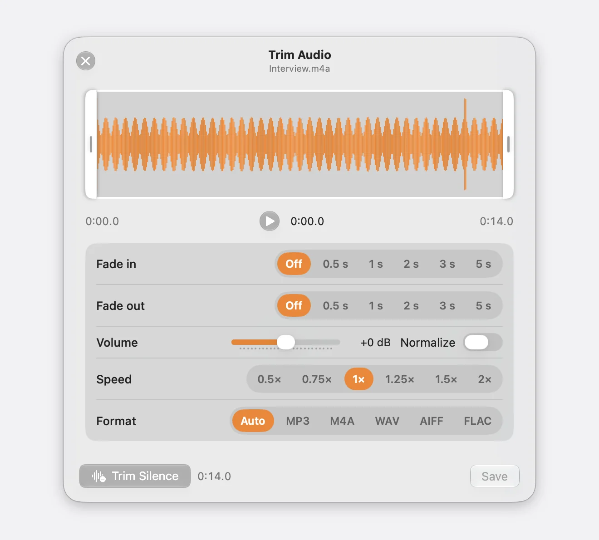</picture>
</p>

- **Trim** with the handles, with the time shown while you drag.
- **Fade in and out**, **volume** in dB, **normalize**, and **speed** from 0.5× to 2×.
- **Format:** keep the original or save as MP3, M4A, WAV, AIFF or FLAC.
- **Trim Silence** finds the quiet parts at the ends.

## Convert, compress and more

Everything runs on the Mac, offline.

| | |
|---|---|
| **Convert images** | JPG, PNG, HEIC, TIFF, GIF, BMP, WebP, AVIF (SVG files open too) |
| **PDF** | pages to images, split into pages, extract chosen pages, merge, compress |
| **Documents** | DOCX, RTF, HTML, TXT, and anything to PDF (see above) |
| **Audio** | MP3, M4A, WAV, AIFF, FLAC |
| **Data** | JSON, CSV, XML into each other; Markdown to HTML, PDF and DOCX |
| **Video** | MP4, MOV, HEVC, ProRes, GIF; MKV, WebM and AVI through ffmpeg; play MKV, AVI, WebM and more |
| **Compress** | images, PDFs, audio and video, with a live size estimate and quality, size or bitrate limits |
| **Text from speech** | transcripts and SRT subtitles with Apple's on-device speech model |
| **Files** | ZIP, unpack archives, strip metadata (camera, location), Get Info |
| **Folders** | ZIP a folder, or run a tool on everything inside it (JPG, PNG, PDF, merge, strip metadata) |
| **Batches** | several files at once, results saved next to each original |

## Looks and themes

Rings, the player and the editor windows are made of glass that you can tune. Pick a **theme** (follow system, light or dark), a **material** (Follow macOS Liquid Glass, Clear, Frosted or Solid), how tinted the glass is, how heavy the blur is, and an **accent colour** (system accent, your own colour, or neutral gray). Reduce Transparency and Increase Contrast are respected.

<p align="center">
  <picture><source media="(prefers-color-scheme: dark)" srcset="docs/images/look-dark.webp"></picture>
</p>

<p align="center"><sub>Columns: Follow macOS · Clear · Frosted · Solid. Rows: light, dark, gradient.</sub></p>

<p align="center">
  <picture><source media="(prefers-color-scheme: dark)" srcset="docs/images/settings-appearance-dark.webp"></picture>
  <picture><source media="(prefers-color-scheme: dark)" srcset="docs/images/settings-general-dark.webp"></picture>
  <picture><source media="(prefers-color-scheme: dark)" srcset="docs/images/menu-dark.webp"></picture>
</p>

## Settings and first launch

A short interactive tour teaches both rings by letting you press the real keys, asks for permissions only when you press Allow, and offers the settings people change first.

<p align="center">
  <picture><source media="(prefers-color-scheme: dark)" srcset="docs/images/tour-0-dark.webp"></picture>
  <picture><source media="(prefers-color-scheme: dark)" srcset="docs/images/tour-1-dark.webp"></picture>
  <picture><source media="(prefers-color-scheme: dark)" srcset="docs/images/tour-2-dark.webp"></picture>
  <picture><source media="(prefers-color-scheme: dark)" srcset="docs/images/tour-3-dark.webp"></picture>
</p>

- **General:** enable, open at login, language, trigger key (Shift or another modifier), reveal results in Finder, recent tools first, pop-up ring and its hold delay, player on or off.
- **Rings:** edit every ring for every kind of file, plus the pop-up ring.
- **Appearance:** theme, accent, glass material, ring size, icons and labels.
- **Menu bar popover:** on/off switch, recent results with errors and **Clear**, Settings and Quit.
- **11 languages:** English, Ukrainian, Spanish, Portuguese, Japanese, Simplified Chinese, Korean, French, Czech, Italian and Indonesian. Follows the system language or the one you pick.

## Privacy and technology

- **No Accessibility permission.** Nothing asks for input monitoring.
- **Permissions only on request.** Opening a ring never raises a system dialog; Bluetooth, Automation (Music, Spotify, System Events) and Files & Folders are requested only when you press Allow.
- **On-device processing.** Vision (OCR, subject masks), Speech, Core Image, AVFoundation and PDFKit; your files are never uploaded and there is no account.
- **What goes over the network.** The license check sends a hash of your Mac's hardware ID (not the ID itself) and, once you activate, your license key and the Mac's name. Besides that: the update check on GitHub and the first-launch downloads below. Nothing else.
- **First-launch components.** The MP3 encoder (a checksum-verified Homebrew bottle), ffmpeg (a static build, checked against a pinned SHA-256) and the speech model are downloaded once, so the app stays small. If you already have ffmpeg from Homebrew, Shiftio uses it.
- **Native.** SwiftUI and Liquid Glass, Apple silicon, 11 languages.

## Author

Dmytro Demchuk ([@mewwtwo](https://github.com/mewwtwo)).
